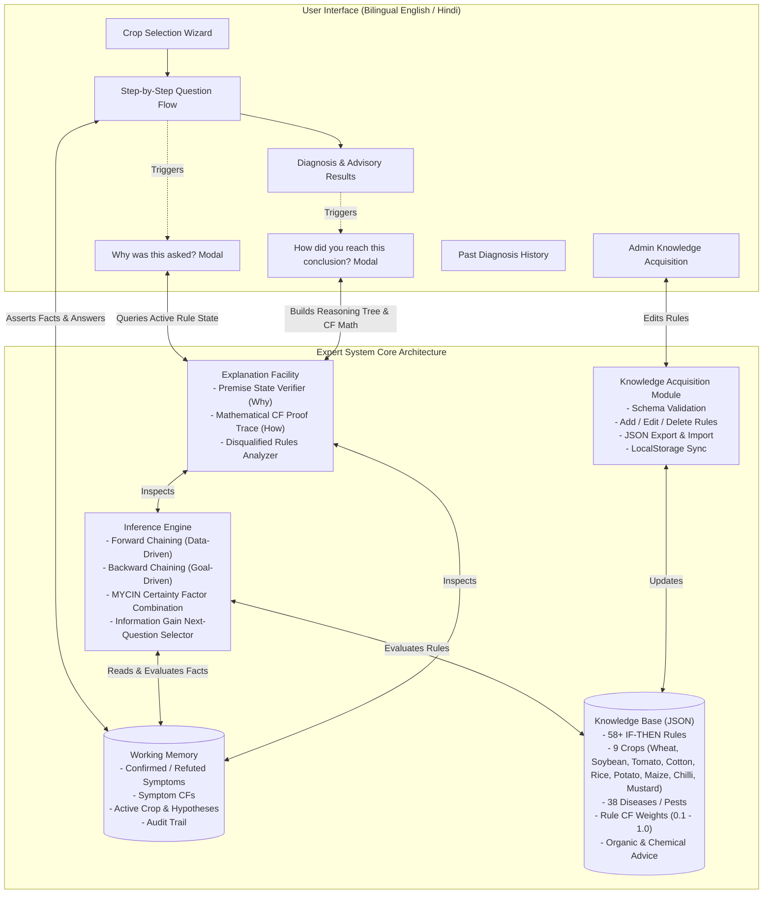

# KrishiMitra (कृषि मित्र) - Architecture & System Design Document

## 1. Executive Summary & Problem Domain
**KrishiMitra** is a rule-based expert system designed to assist smallholder farmers in diagnosing crop diseases, understanding the underlying cause of infection, and obtaining reliable, step-by-step organic and chemical treatment advice in simple, low-literacy language.

The application adheres strictly to the classic AI expert system paradigm, featuring full separation between the **Knowledge Base**, the **Inference Engine**, **Working Memory**, **Explanation Facility**, **Knowledge Acquisition Module**, and **User Interface**.

---

## 2. Core Components

### 2.1 Knowledge Base (KB)
- **Format**: Structured JSON array in `data/knowledge_base.json` and mirrored in `js/rules_data.js`.
- **Coverage**: 9 common crops, 58 comprehensive rules, and 38 distinct diseases and pests:
  1. **Wheat (गेहूं)**: Yellow Rust, Brown Rust, Loose Smut, Karnal Bunt, Powdery Mildew, Wheat Aphids.
  2. **Soybean (सोयाबीन)**: Yellow Mosaic Virus (YMV), Soybean Rust, Charcoal Rot, Anthracnose & Pod Blight, Girdle Beetle.
  3. **Tomato (टमाटर)**: Early Blight, Late Blight, Tomato Leaf Curl Virus (ToLCV), Bacterial Wilt, Tomato Fruit Borer.
  4. **Cotton (कपास)**: Pink Bollworm (PBW), Cotton Leaf Curl Virus (CLCuV), Bacterial Blight (Black Arm), Verticillium Wilt, Whitefly Infestation.
  5. **Rice (धान / चावल)**: Bacterial Leaf Blight (BLB), Rice Blast, Sheath Blight, Brown Plant Hopper (BPH), Yellow Stem Borer.
  6. **Potato (आलू)**: Late Blight (Water-soaked dark lesions, white fungal growth), Early Blight (Target-board rings).
  7. **Maize (मक्का)**: Fall Armyworm (Ragged leaf holes, frass inside whorls), Maydis Leaf Blight (Elliptical tan lesions).
  8. **Chilli (मिर्च)**: Chilli Leaf Curl / Murda Complex (Upward leaf curling, stunted growth), Anthracnose / Fruit Rot (Sunken circular spots).
  9. **Mustard (सरसों)**: Mustard Aphid (Yellowing, curling, sticky honeydew), White Rust (White raised blisters on leaf undersides).
- **Rule Anatomy**:
  - `id`: Unique identifier (e.g., `RULE_TOM_01`).
  - `crop`: Target crop identifier (`wheat`, `soybean`, `tomato`, `cotton`, `rice`, `potato`, `maize`, `chilli`, `mustard`).
  - `conditions`: Array of prerequisite symptom keys (e.g., `["concentric_rings_target_spots", "lower_leaves_affected"]`).
  - `conclusion`: Target disease key (e.g., `tomato_early_blight`).
  - `disease_name`: Bilingual object (`{ en: "Early Blight", hi: "अगेती झुलसा" }`).
  - `cf`: Rule confidence factor ($0.10 \le CF \le 1.00$).
  - `treatment`: Bilingual recommendations for **organic** bio-pesticides and **chemical** fungicides/insecticides.
  - `prevention`: Cultural and preventive management techniques.

### 2.2 Working Memory (WM)
The Working Memory maintains the state of the active diagnostic session:
- **`facts`**: A key-value map storing user observations:
  $$\text{fact} = \{\text{value}: \text{boolean}, \text{cf}: [0.0, 1.0], \text{timestamp}: t\}$$
- **`crop`**: Currently selected crop.
- **`mode`**: Reasoning strategy (`'forward'` or `'backward'`).
- **`activeHypothesis`**: Goal disease currently under evaluation in backward chaining.
- **`rulesFired`**: Chronological log of successfully executed rules.
- **`rulesEvaluated`**: Audit trail of all rules evaluated, including disqualified rules.
- **`questionHistory`**: Stack of answered questions facilitating back-tracking and undo.

### 2.3 Inference Engine (IE)
The Inference Engine executes automated reasoning and supports two complementary inference strategies:

#### A. Forward Chaining (Data-Driven / Bottom-Up)
1. User selects a crop, activating all rules matching `rule.crop == activeCrop`.
2. The engine determines the optimal next question by computing symptom frequency across rules that remain viable (not yet disproven).
3. The farmer answers with confidence:
   - **Yes, definitely**: $CF = 1.0$
   - **Likely / Mildly present**: $CF = 0.65$
   - **Unsure / Skip**: $CF = 0.0$ (unasserted)
   - **No, not observed**: $CF = 0.0, \text{value} = \text{false}$ (refutes dependent rules)
4. For each rule whose conditions are satisfied, the derived Certainty Factor is calculated:
   $$CF_{premise} = \min_{c_i \in \text{conditions}}(CF(c_i))$$
   $$CF_{derived}(R) = CF_{premise} \times CF(R)$$
5. Evidence Combination: When multiple rules conclude the same disease $D$, evidence is combined using the classic **MYCIN Certainty Factor formula**:
   $$CF_{comb}(CF_1, CF_2) = CF_1 + CF_2 \times (1 - CF_1)$$
   For $n$ rules:
   $$CF_{final} = \text{Fold}(CF_{comb}, [CF(R_1), CF(R_2), \dots, CF(R_n)])$$
6. All candidate diseases are sorted descending by $CF_{final}$, surfacing the **Top 3** diagnoses.

#### B. Backward Chaining (Goal-Driven / Top-Down)
1. System establishes candidate disease goals for the crop.
2. Selects a candidate goal hypothesis $H$ (e.g. `rice_bacterial_leaf_blight`).
3. Examines all rules concluding $H$.
4. Queries Working Memory for required symptom premises.
5. If any premise is unknown, the engine generates targeted questions specifically required to verify or refute hypothesis $H$.
6. If the user refutes an essential condition ($CF = 0$), the active hypothesis is disproven, and the engine automatically switches to the next viable candidate goal.
7. If all premises are met, the hypothesis is confirmed and displayed with the derived certainty factor.

### 2.4 Explanation Facility (EF)
Provides complete algorithmic transparency:
- **"Why was this asked?"**:
  - Displays the active reasoning mode (Forward Chaining or Backward Chaining).
  - Identifies the target rule(s) and disease(s) requiring this symptom.
  - Lists current condition satisfaction status (which conditions are already met vs. which are being tested).
  - Shows the potential certainty factor gain upon confirmation.
- **"How did you reach this conclusion?"**:
  - **Fired Rules Breakdown**: Details rule IDs, satisfied premises, individual rule CFs, and premise CFs.
  - **Mathematical Proof Trace**: Exact step-by-step MYCIN combination formula showing intermediate values.
  - **Working Memory Audit**: Table of all symptoms reported by the farmer with timestamp and confidence level.
  - **Disqualified Rules**: Detailed reasons why alternative crop diseases were eliminated (e.g. failed premise condition).

### 2.5 Knowledge Acquisition Module (KAM)
- Provides a clean administrative interface (`#view-admin`) to Add, Edit, and Delete rules without touching JavaScript or backend code.
- Features multi-select symptom pickers, certainty factor sliders, and bilingual treatment editors.
- Supports **JSON Export** (downloads updated `knowledge_base.json`), **JSON Import** (uploads external rule definitions with schema validation), and a **Reset to Defaults** safeguard.
- Persists all changes to browser `localStorage`.

### 2.6 User Interface & Accessibility
- **High-Contrast Farmer Palette**: Deep agriculture emerald green (`#1b5e20`), warm harvest amber (`#d97706`), clean white (`#ffffff`), and bold dark slate (`#0f172a`).
- **Low-Literacy Friendly**: Large icons (🌾, 🍅, 🐛, 🎯), big touch targets ($\ge 48$px to 64px), clear yes/no/mild cards.
- **Bilingual English & Hindi**: Instant one-click toggle seamlessly updates every prompt, title, button, symptom question, and treatment advisory.
- **Past Diagnoses History**: Stores past consultations locally with timestamp, crop, primary diagnosis, and advice review capability.
- **Statutory Extension Advisory**: Prominent disclaimer advising farmers to consult local Krishi Vigyan Kendras (KVK) or agriculture extension officers for severe or epidemic outbreaks.
